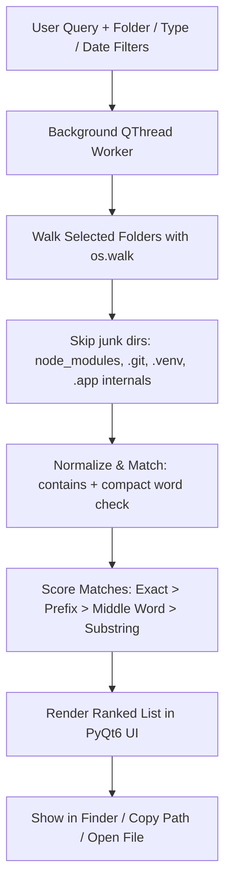

# FastSearch

**TL;DR:** A fast, 100% local macOS file search app built with Python and PyQt6 that skips Spotlight and actually finds your files.

## Why I Built This

Have you ever stared right at a PDF sitting inside your Documents folder, typed its name into Finder, and watched Finder return zero results? That happened to me one too many times. Finder relies on Spotlight's index, which often lags, breaks, or misses partial filenames. I wanted a simple local tool that scans my folders directly, handles messy filenames, and lets me jump straight to the file in Finder.

## Features

- **100% Local & Private:** Runs completely on your Mac with zero cloud calls, no background daemons, and no stale index.
- **Normalized & Contains Search:** Case-insensitive and accent-insensitive. It treats `-`, `_`, and `.` cleanly and detects both compound and middle words (searching `fee` finds `fee_file.pdf`, `_fee.pdf`, `file_fee.pdf`, and `feefile.pdf`).
- **Prefix-Priority Ranking:** Files that start with your query always rank higher. For a query like `fee`, `fee_file.pdf` shows up above `file_fee.pdf`.
- **Folder Filters:** One-click toggles for **Desktop**, **Documents**, **Downloads**, and **Applications**, plus a button to add any custom folder.
- **File Type & Extension Filters:** Filter by presets (**PDF**, **Docs**, **Images**, **Code**, **Media**, **Archives**, **Folders**) or type custom extensions like `csv, json`.
- **Date Created Range:** Optional From/To calendar pickers that filter strictly on macOS file creation date (`st_birthtime`).
- **Quick Actions:** View the full file path, click **Show in Finder**, **Copy Path**, or double-click any row to open the file directly.

## How It Works



## Tech Stack & Choices

- **Python 3 + PyQt6:** You could build this with Tkinter or native SwiftUI, but PyQt6 gives sharp Retina rendering, built-in calendar pickers, and smooth background threading (`QThread`) so the UI never freezes while scanning, all without wrestling with Xcode toolchains.
- **Standard Library (`os.walk`, `unicodedata`, `subprocess`):** Direct filesystem traversal keeps things lightweight, `unicodedata` handles text normalization, and `open -R` reveals the exact file in Finder.

## Quick Start

1. **Install PyQt6:**
   ```bash
   pip3 install PyQt6
   ```

2. **Run the app:**
   ```bash
   python3 fast_search.py
   ```

3. **(Optional) Add a `search` shortcut to your Terminal:**
   Add this to your `~/.zshrc` (update the paths to match your setup):
   ```bash
   search() {
       (source /path/to/your/venv/bin/activate && nohup python3 /path/to/fast_search.py >/dev/null 2>&1 &)
   }
   ```
   Reload with `source ~/.zshrc`, then just type `search` from anywhere to launch the app.

> [!IMPORTANT]
> **macOS Folder Permissions (Read This First!)**
>
> macOS blocks Terminal and Python from reading protected folders like **Documents**, **Desktop**, and **Downloads** by default. Because Python's `os.walk()` skips unreadable folders silently, FastSearch will return **0 results** until you grant permission.
>
> **How to enable it:**
> 1. Open **System Settings > Privacy & Security > Files and Folders** (or **Full Disk Access**).
> 2. Find your terminal app (**Terminal**, **iTerm**, or **VS Code**).
> 3. Toggle access **ON** for Documents, Desktop, and Downloads.
> 4. Restart your terminal and run the app again.

## Final Note

Well, that's it! I hope this tool saves you time and frustration when searching for files on your Mac. If you have any feedback or feature requests, feel free to open an issue or submit a pull request. Happy searching!